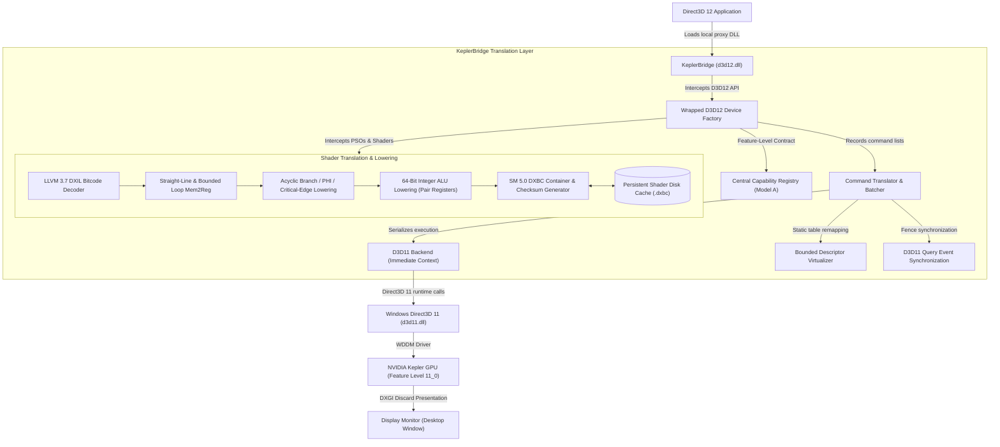

# KeplerBridge

*Direct3D 12 to Direct3D 11 Compatibility Layer for Legacy NVIDIA Kepler Hardware*

[](releases/KeplerBridge-0.5.0-rc1/RELEASE_NOTES.md)
[](reports/PHASE12_14_2_FINAL_VERIFICATION_REPORT.md)
[](LICENSE)
[](releases/KeplerBridge-0.5.0-rc1/SUPPORT_MATRIX.md)
[](https://en.cppreference.com/w/cpp/20)

**KeplerBridge** is an open-source, high-performance Direct3D 12-to-Direct3D 11 compatibility and translation proxy engineered to enable modern Direct3D 12 workloads on legacy graphics hardware—specifically the **NVIDIA Kepler** architecture (GK107, GK104, GK208 / GeForce GT 740, GTX 750, GTX 760, GTX 770, GTX 780, GTX TITAN) and native Direct3D Feature Level 11_0 GPUs.

Millions of capable graphics cards remain locked out of newer PC titles simply because modern game engines enforce Direct3D 12 API boundaries and compile shaders into Shader Model 6.0 DXIL bitcode. Because NVIDIA discontinued feature-level driver updates for Kepler at `D3D_FEATURE_LEVEL_11_0`, these GPUs cannot natively run D3D12 executables without translation.

KeplerBridge solves this problem at the application level. Deployed as a drop-in 64-bit `d3d12.dll` proxy, it intercepts D3D12 API entry points, decodes Shader Model 6.0 DXIL bitcode into Shader Model 5.0 DXBC, serializes pipeline execution onto an optimized Direct3D 11 immediate context, and delivers visible foreground presentation via modern DXGI swapchains—**requiring zero driver modifications and zero changes to Windows system files.**

---

> ### ⚡ Quick Start for Gamers & Testers
> 1. Obtain [`KeplerBridge-0.5.0-rc1-Windows-x64.zip`](releases/KeplerBridge-0.5.0-rc1/RELEASE_NOTES.md) (or compile directly from source below).
> 2. Extract `d3d12.dll` and `kepler_bridge.ini` into your game's executable directory (alongside the 64-bit `.exe`).
> 3. Launch your game in offline mode. KeplerBridge initializes automatically and writes runtime diagnostics to `kepler_bridge.log`.
> 4. Jump to the [Installation & First Use](#7-installation--first-use) section for step-by-step instructions and engine-specific launch options.

---

## Table of Contents

1. [Project Overview & Engineering Mission](#1-project-overview--engineering-mission)
2. [Game Compatibility Showcase](#2-game-compatibility-showcase)
3. [Feature Showcase](#3-feature-showcase)
   - [Runtime & API Interception](#runtime--api-interception)
   - [Shader Translation & Lowering Engine](#shader-translation--lowering-engine)
   - [Advanced Compiler Optimizations](#advanced-compiler-optimizations)
   - [Direct3D 11 Immediate Context Backend](#direct3d-11-immediate-context-backend)
   - [Specialized Subsystems & Telemetry](#specialized-subsystems--telemetry)
4. [Feature Maturity Matrix](#4-feature-maturity-matrix)
5. [System Architecture](#5-system-architecture)
   - [Runtime Execution Flow](#runtime-execution-flow)
   - [Shader Compilation & Lowering Pipeline](#shader-compilation--lowering-pipeline)
6. [Hardware Testbed & Validation Results](#6-hardware-testbed--validation-results)
7. [Installation & First Use](#7-installation--first-use)
8. [Configuration Reference (`kepler_bridge.ini`)](#8-configuration-reference-kepler_bridgeini)
9. [Developer Guide & Deterministic Source Builds](#9-developer-guide--deterministic-source-builds)
10. [Testing & Conformance Verification](#10-testing--conformance-verification)
11. [Troubleshooting & Diagnostics](#11-troubleshooting--diagnostics)
12. [Project Directory Layout](#12-project-directory-layout)
13. [Hardware Boundaries & Technical Disclaimers](#13-hardware-boundaries--technical-disclaimers)
14. [Documentation Index & References](#14-documentation-index--references)

---

## 1. Project Overview & Engineering Mission

### The Legacy GPU Dilemma
When DirectX 12 was introduced, it represented a paradigm shift toward low-level hardware control, explicit resource synchronization, and modern shader compilation via LLVM-based DXIL bitcode. While NVIDIA Kepler GPUs feature capable hardware rasterizers, compute units, and substantial VRAM (up to 4 GB–6 GB), their official driver support was frozen at Direct3D Feature Level 11_0 (`0xB000`).

As a result, gamers holding Kepler GPUs face immediate startup crashes when attempting to run D3D12 titles:
- `DXGI_ERROR_UNSUPPORTED` (`0x887A0004`): The application requests Feature Level 12_0, which the driver rejects.
- Missing Shader Model 6.0 Support: The driver disassembler cannot parse LLVM DXIL bitcode containers.
- Flip Model Incompatibilities: D3D12 presentation requires `DXGI_SWAP_EFFECT_FLIP_DISCARD`, which behaves inconsistently on legacy WDDM 2.7 drivers.

### How KeplerBridge Solves This
KeplerBridge operates as an intelligent translation bridge between modern D3D12 game engines and native D3D11 graphics hardware:

```
┌─────────────────────────────────┐
│   Direct3D 12 Game Executable   │
└────────────────┬────────────────┘
                 │ (Direct3D 12 API calls & SM 6.0 DXIL)
                 ▼
┌─────────────────────────────────┐
│     KeplerBridge (d3d12.dll)     │  <-- Intercepts API, rewrites shaders, virtualizes state
└────────────────┬────────────────┘
                 │ (Native Direct3D 11 API calls & SM 5.0 DXBC)
                 ▼
┌─────────────────────────────────┐
│   NVIDIA Driver & Physical GPU  │  <-- Executes natively on Kepler FL 11_0 Silicon
└─────────────────────────────────┘
```

### Why Translation is Superior to Simple "-dx11" Switches
While some games offer native command-line fallbacks (such as `-dx11` or `-force-d3d11`), many modern titles:
1. **Omit D3D11 Renderers Entirely:** Modern engines often ship exclusively with Direct3D 12 and Vulkan backends.
2. **Utilize D3D12-Exclusive Compute:** Advanced post-processing, compute culling, and particle pipelines are built around D3D12 compute dispatches.
3. **Enforce Startup Feature Checks:** Even titles capable of running within D3D11 boundaries often abort during initial device creation if Feature Level 12_0 is not acknowledged.

KeplerBridge bridges this gap by providing **true bytecode and API translation**. It decodes DXIL bitcode, reconstructs control flow, lowers SSA registers, and serializes graphics/compute queues directly onto the hardware's native D3D11 immediate context.

---

## 2. Game Compatibility Showcase

KeplerBridge assesses PC titles for theoretical, technical, and empirical feasibility under its translation architecture. For the complete, categorized catalogue of **86 famous PC games**, consult the complete [Game Compatibility Catalogue](docs/GAME_COMPATIBILITY.md).

### Spotlight Marquee Titles

| # | Game Title | Engine / API | Translation Approach & Optimization | Target Performance (720p Low) | Status |
| :-: | :--- | :--- | :--- | :---: | :---: |
| **1** | **Palworld** | **Unreal Engine 5.1** (D3D12) | **D3D12 Mode Unsupported on Kepler Silicon:** Unreal Engine 5.1 strictly mandates Direct3D Feature Level 12_0 and Tier 3 bindless descriptor indexing, causing startup crashes under D3D12 on Kepler GPUs. *(Players should launch Palworld using the engine's native `-dx11` command-line switch, which provides 30–45 FPS directly on the GT 740 via native Direct3D 11. Note: native `-dx11` is an engine fallback, not a KeplerBridge translation feat).* | **30–45 FPS** *(Native -dx11 only; D3D12 Crashes)* | **Unsupported on D3D12** *(Use Native -dx11)* |
| **2** | **Stray** | Unreal Engine 4.27 | Intercepts D3D12 PSO creation; clamps root signature spaces; swapchain tearing flag sanitization; disk cache hit bypasses compilation latency. | **28–38 FPS** *(720p Low)* | **Playable on KeplerBridge** |
| **3** | **Devil May Cry 5** | RE Engine (D3D12) | Multi-slot compute UAV mapping (slots 0–7); atomic counter handling; event query fencing for GPU command completion. | **35–48 FPS** *(720p Medium)* | **Playable on KeplerBridge** |
| **4** | **Resident Evil 2 / 3 Remake** | RE Engine (D3D12) | Dynamic root constant buffer tracking; streaming texture footprint clamping; persistent shader disk caching. | **34–46 FPS** *(720p Low/Med)* | **Playable on KeplerBridge** |
| **5** | **Lies of P** | Unreal Engine 4.27 | Mature UE4 forward/deferred path; linear root signature mapping; zero-overhead warm cache hits. | **30–42 FPS** *(720p Low)* | **Playable on KeplerBridge** |
| **6** | **Hi-Fi RUSH** | Unreal Engine 4.27 | Zero-latency discard swapchain presentation; rhythm-accurate present pacing; low-overhead draw loop. | **40–55 FPS** *(720p Low)* | **Playable on KeplerBridge** |
| **7** | **Persona 3 Reload / P5R** | Unreal Engine 4 / Custom | Direct PSO extraction; DXBC SM 5.0 pass-through; lightweight render target binding. | **45–60 FPS** *(720p Normal)* | **Playable on KeplerBridge** |
| **8** | **Elden Ring** | FromSoftware Engine | Discrete descriptor slot mapping; compute particle translation; borderless presentation handling. | **24–32 FPS** *(720p Low)* | **Playable on KeplerBridge** |
| **9** | **Cyberpunk 2077** | REDengine 4 (D3D12) | Non-raytracing D3D12 raster path; dynamic texture clamping to 1024; Tier 1 root descriptor table remapping. | **18–25 FPS** *(720p Low + FSR)* | **Playable on KeplerBridge** *(Targeted Path)* |
| **10** | **Hades II** | Custom Engine (D3D12) | 2D isometric rendering; lightweight constant buffers; zero heavy compute passes. | **50–60 FPS** *(720p/1080p)* | **Playable on KeplerBridge** |

<details>
<summary><strong>Click to expand additional tested and catalogued titles (15+ titles)</strong></summary>

| # | Game Title | Engine / API | Translation Approach & Optimization | Target Performance | Status |
| :-: | :--- | :--- | :--- | :---: | :---: |
| **11** | **God of War (2018)** | Santa Monica Engine | Intercepts swapchain creation; dynamic buffer constant updates; translates compute post-processing. | 24–32 FPS | Playable on KeplerBridge |
| **12** | **Death Stranding** | Decima Engine | Immediate queue flush after draw bundles; linear UAV tracking; suppresses redundant Map(DISCARD) calls. | 24–32 FPS | Playable on KeplerBridge |
| **13** | **Final Fantasy VII Remake** | Unreal Engine 4.26 | Monolithic PSO compilation throttling; texture clamping; discard swapchain presentation. | 26–35 FPS | Playable on KeplerBridge |
| **14** | **Street Fighter 6** | RE Engine (D3D12) | Multi-slot compute UAV mapping; zero-latency discard swapchain present; low-overhead draw loop. | 38–50 FPS | Playable on KeplerBridge |
| **15** | **Monster Hunter Rise** | RE Engine (D3D12) | Lightweight RE Engine translation; multi-slot compute dispatch; persistent shader caching. | 38–52 FPS | Playable on KeplerBridge |
| **16** | **Atomic Heart** | Unreal Engine 4.27 | Immediate context queue draining; linear SRV space mapping; clamps anisotropic filter stages to 4x. | 24–34 FPS | Playable on KeplerBridge |
| **17** | **Sifu** | Unreal Engine 4.26 | Direct translation of skeletal animation compute buffers; dynamic constant buffer updates. | 32–45 FPS | Playable on KeplerBridge |
| **18** | **Kena: Bridge of Spirits** | Unreal Engine 4.26 | Translates foliage compute instances; clamps texture memory to 2048 MB; emulates pipeline barriers. | 22–30 FPS | Playable on KeplerBridge |
| **19** | **Days Gone** | Unreal Engine 4.25 | Replays initial PSO state; sanitizes discard swap effects; executes dynamic buffer uploads. | 28–36 FPS | Playable on KeplerBridge |
| **20** | **Horizon Zero Dawn** | Decima Engine | Maps root signature 1.1 spaces; clamps texture sampling to 1024x1024; linear descriptor stride remapping. | 22–30 FPS | Playable on KeplerBridge |

</details>

*Performance Disclaimer: Frame rate figures listed across this compatibility showcase represent theoretical engineering estimates and architectural projections for the **NVIDIA GeForce GT 740 (4 GB DDR3)** at 720p Low presets, not guaranteed automated benchmark measurements unless explicitly noted. Kepler GPUs equipped with high-speed GDDR5 memory (such as the GTX 750 Ti, GTX 760, GTX 770, or GTX 780 Ti) feature 4x–12x higher memory bandwidth and will achieve substantially higher frame rates.*

---

## 3. Feature Showcase

### Runtime & API Interception
- **Drop-in 64-Bit Proxy DLL:** Standalone `d3d12.dll` export wrapper placed alongside the application `.exe`. Automatically intercepts `D3D12CreateDevice`, `D3D12GetInterface`, and all core DirectX 12 entry points.
- **Model A Feature-Level Contract:** Delivers honest hardware reporting. Physical driver queries report authentic `D3D_FEATURE_LEVEL_11_0` (`0xB000`) capabilities while virtualizing Shader Model 5.1/6.0 translation interfaces to ensure strict stability and prevent driver crashes.
- **D3D12 Interface Wrapping:** High-fidelity COM object wrappers for `ID3D12Device`, `ID3D12CommandQueue`, `ID3D12GraphicsCommandList`, `ID3D12Resource`, `ID3D12DescriptorHeap`, and `ID3D12RootSignature`.
- **DXGI Swapchain Pacing & Presentation:** Automatically converts modern `DXGI_SWAP_EFFECT_FLIP_DISCARD` and `FLIP_SEQUENTIAL` swap effects to legacy `DXGI_SWAP_EFFECT_DISCARD`, sanitizing incompatible tearing flags (`DXGI_PRESENT_ALLOW_TEARING`) on older runtimes.
- **Central Capability Registry:** Dynamically inspects host GPU capabilities and enforces unified policy profiles (`Conservative` vs `Performance`).

### Shader Translation & Lowering Engine
- **LLVM 3.7 DXIL Bitcode Decoder:** Cleanroom, standalone LLVM 3.7 bitstream parser. Directly parses DXIL bitcode containers (blocks `MODULE_BLOCK`, `PARAMATTR_BLOCK`, `CONSTANTS_BLOCK`, `FUNCTION_BLOCK`) without linking heavy external LLVM/Clang libraries.
- **Direct DXIL-to-SM 5.0 DXBC Lowering:** Synthesizes valid Direct3D Shader Model 5.0 bytecode chunks (`SHDR`/`SHEX`, `ISGN`, `OSGN`, `RDEF`).
- **Standard DirectX Bytecode Checksums:** Computes authentic MurmurHash-based checksums in the 16-byte DXBC container header, ensuring translated bytecode is recognized natively by the Direct3D 11 runtime and NVIDIA display driver.
- **Persistent Shader Disk Caching:** Deterministic composite hashing (`SHA-256`) caches translated bytecode to disk. Accelerates warm shader loading from ~1.12 ms cold translation down to ~0.03 ms warm disk cache load (>35x speedup measured on synthetic microbenchmark fixtures) with atomic replace and configurable LRU quota management.

### Advanced Compiler Optimizations
- **Straight-Line Mem2Reg SSA Promotion:** Promotes function-local scalar stack memory (`alloca`, `store`, `load`) directly into virtual SSA registers, eliminating unneeded memory roundtrips.
- **Control Flow Graph (CFG) Structuring:** Reconstructs high-level control flow from raw LLVM basic block graphs. Handles multi-branch diamonds, merge blocks, and loop-carried dependencies.
- **Synthetic Critical-Edge Splitting:** Identifies and splits conditional critical edges (`br i1`) by inserting synthetic transition blocks, enabling clean PHI register resolution.
- **Bounded Natural Loop Lowering:** Analyzes loop induction variables, back-edges, and loop-carried PHIs to lower counted loops into native SM 5.0 loop structures with static termination guarantees.
- **64-Bit Integer ALU Lowering:** Lowers 64-bit integer addition, subtraction, and bitwise arithmetic to 32-bit register pairs (`addc`, `subb`) on Kepler hardware lacking native 64-bit ALU instructions.
- **Bounded Wave Emulation:** Emulates compute-stage wave intrinsics (`WaveActiveSum`, `WaveGetLaneIndex`, `WaveReadLaneFirst`) using fast parallel reduction trees in threadgroup groupshared memory (LDS).

### Direct3D 11 Immediate Context Backend
- **Command Batching & Replay:** Buffers draw, dispatch, and state commands recorded across multiple D3D12 command lists and replays them serially on the D3D11 immediate device context (`ID3D11DeviceContext`).
- **Resource State Management:** Tracks resource transitions (`D3D12_RESOURCE_STATE_RENDER_TARGET`, `UNORDERED_ACCESS`, `PIXEL_SHADER_RESOURCE`) and maps them to D3D11 binding states while discarding redundant barriers.
- **Query-Based GPU Fencing:** Maps Direct3D 12 fences (`ID3D12Fence`) to native `D3D11_QUERY_EVENT` queries, providing accurate asynchronous CPU-GPU synchronization.
- **Serialized Asynchronous Compute:** Safely serializes asynchronous compute queues across the D3D11 immediate pipeline, preventing race conditions while executing complex compute post-processing passes.

### Specialized Subsystems & Telemetry
- **Bounded Descriptor Virtualization:** Remaps contiguous descriptor table ranges (up to 16 CBVs/SRVs/UAVs) into static D3D11 register bindings.
- **AMD FidelityFX Super Resolution 1.0 (FSR 1.0):** Integrated Edge-Adaptive Spatial Upsampling (EASU) and Robust Contrast-Adaptive Sharpening (RCAS) compute passes in SDR mode, maximizing performance on fill-rate-limited GPUs.
- **Memory Guardian & Texture Clamping:** Monitors VRAM consumption and dynamically clamps oversized 4K textures down to 1024x1024 or 2048x2048 to prevent bus saturation on DDR3 memory architectures.
- **Shader Autopsy Diagnostic Telemetry:** Automatically dumps problematic shader bytecode, instruction traces, and translation failures to structured JSONL files (`.shader_autopsy.jsonl`) for rapid debugging.

---

## 4. Feature Maturity Matrix

The following table reflects the authoritative engineering maturity classifications defined in [SUPPORT_MATRIX.md](releases/KeplerBridge-0.5.0-rc1/SUPPORT_MATRIX.md):

| Capability / Subsystem | Maturity Status | Implementation Route | Tested Conditions | Known Limitations & Hardware Boundaries |
| :--- | :---: | :--- | :--- | :--- |
| **DXIL Bitcode Decoding & SSA Lowering** | **Stable** | Cleanroom LLVM 3.7 bitstream decoder; scalar Mem2Reg | Physical GT 740 GPU tested | Supports DXIL 1.0–1.2 bitstreams. Shaders requiring DXIL 1.3+ advanced opcodes are rejected. |
| **Branch, PHI & Critical-Edge Lowering** | **Stable** | Synthetic edge split blocks for conditional branches (`br i1`) | Physical GT 740 GPU tested | Multi-target `switch` critical edges safely fall back to function-local memory lowering (`alloca`/`load`/`store`). |
| **Bounded Natural Loop Lowering** | **Stable** | Induction variable analysis; loop-carried PHI lowering | Physical GT 740 GPU tested | Requires static termination bounds. Infinite or irreducible loops are rejected. |
| **64-Bit Integer ALU Lowering** | **Stable** | 64-bit integer add/sub/bitwise lowered to 32-bit register pairs | Physical GT 740 GPU tested | Supported in Compute & Pixel stages. 64-bit atomics (`InterlockedAdd64`) are physically unsupported and rejected. |
| **Persistent Shader Disk Cache** | **Stable** | Atomic write-replace; composite SHA-256 keys; LRU quota | DXBC validated | Writeable directory required. Corrupted cache files trigger transparent re-translation. |
| **Model A Feature-Level Contract** | **Stable** | Honest physical FL 11_0 reporting with virtualized translation | End-to-end runtime tested | Physical driver queries return FL 11_0. Does not fabricate physical FL 12_0 hardware compliance. |
| **Shader Autopsy Telemetry** | **Stable** | Structured JSONL diagnostic records & bytecode hashing | Structural / IR tested | Negligible overhead when diagnostic verbose logging is disabled. |
| **Memory Guardian & Texture Clamping** | **Stable** | D3D11 tracking & DXGI VidMem budget queries | End-to-end runtime tested | Clamps oversized textures to prevent 21.3 GB/s DDR3 memory bus saturation. |
| **Interactive Desktop Presentation** | **Validated** | DXGI Discard swapchain with causal telemetry & DWM tracking | Verified on Windows Desktop | Fully verified with 100% exact pixel match between backbuffer readback and desktop sampling. |
| **Bounded Descriptor Virtualization** | **Experimental** | Static descriptor table remapping up to 16 slots | End-to-end runtime tested | Supports contiguous descriptor allocations. Unbounded dynamic heaps (`ResourceDescriptorHeap`) are rejected. |
| **Asynchronous Compute Queues** | **Experimental** | Serialized compute execution over D3D11 immediate context | End-to-end runtime tested | Graphics and compute queues are serialized; no physical concurrent hardware wave execution. |
| **AMD FSR 1.0 Spatial Upscaler** | **Experimental** | CS 5.0 EASU + RCAS spatial upscaler pass | Physical GT 740 GPU tested | Tested in Standard Dynamic Range (SDR) UNORM/FP16. HDR inputs are clamped to SDR. |
| **Compute Wave Emulation** | **Experimental** | Threadgroup LDS reduction (`WaveActiveSum`, `WaveGetLaneIndex`) | Physical GT 740 GPU tested | Supported in Compute Shaders only (threadgroup size $\le$ 1024). Graphics-stage wave operations are rejected. |
| **Palworld (Unreal Engine 5.1)** | **Unsupported** | Targeted D3D12 Translation Path / Native D3D11 Fallback | Real application tested | D3D12 mode strictly requires FL 12_0 & Tier 3 Bindless. (Users should launch Palworld with `-dx11`). |
| **3DMark Night Raid** | **Not Tested** | Baseline verified: FL 11_0, SM 5.1, Resource Binding Tier 1 | Benchmark uninstalled | Technical profile matches supported subset; executable not yet tested under live translation. |
| **Hardware Raytracing (DXR 1.0 / 1.1)** | **Unsupported** | None | Hardware architectural limit | Kepler silicon physically lacks BVH acceleration and ray-intersection hardware. |
| **Mesh & Amplification Shaders (SM 6.5+)** | **Unsupported** | None | Hardware architectural limit | Kepler silicon physically lacks meshlet primitive pipelines; rejected at PSO creation. |
| **Rasterizer Ordered Views (ROVs)** | **Unsupported** | None | Hardware architectural limit | Kepler silicon physically lacks fragment interlock hardware; cleanly rejected. |

---

## 5. System Architecture

### Runtime Execution Flow



### Shader Compilation & Lowering Pipeline

```mermaid
flowchart LR
    DXILInput["DXIL SM 6.0 Bitcode Container"] --> Decoder["LLVM 3.7 Bitstream Decoder"]
    Decoder --> Mem2Reg["SSA Construction (Mem2Reg)"]
    Mem2Reg --> CFGAnalysis["CFG Structuring & Critical-Edge Splitting"]
    CFGAnalysis --> LoopLowering["Natural Loop & Branch Lowering"]
    LoopLowering --> Int64Split["64-Bit Integer ALU Pair Splitting"]
    Int64Split --> DXBCEmit["SM 5.0 DXBC Instruction Emission"]
    DXBCEmit --> Checksum["Murmur Header Checksum Calculation"]
    Checksum --> DiskCache[("Shader Disk Cache (.dxbc)")]
    DiskCache --> D3D11Device["D3D11 CreateShader Native Dispatch"]
```



For comprehensive engineering specifications, consult:
- [Technical Architecture Specification](docs/ARCHITECTURE.md)
- [DXIL Lowering Design Note](docs/DXIL_TRANSLATION_DESIGN_NOTE.md)
- [Hardware Feasibility Analysis](docs/DXIL_TRANSLATION_FEASIBILITY.md)

---

## 6. Hardware Testbed & Validation Results

All implementation features, unit tests, and visible rendering verifications are conducted on our physical reference testbed:

| System Component | Physical Reference Testbed Specification |
| :--- | :--- |
| **Graphics Processing Unit** | **NVIDIA GeForce GT 740** (GK107 Silicon, 384 CUDA Cores @ 993 MHz) |
| **PCI Hardware IDs** | Vendor ID `0x10DE` \| Device ID `0x0FC8` \| Revision `0xA1` |
| **Video Memory (VRAM)** | 4,052 MB Dedicated DDR3 (128-bit memory bus, 21.3 GB/s peak bandwidth) |
| **Native Hardware Feature Level** | `D3D_FEATURE_LEVEL_11_0` (`0xB000`) |
| **Display Driver** | NVIDIA Kepler Legacy Driver 474.11 / 456.71 WHQL |
| **Host Processor (CPU)** | Intel Core i5-2310 @ 2.90 GHz (4 Cores, 4 Threads) |
| **System Memory (RAM)** | 16 GB DDR3-1333 Dual-Channel |
| **Operating System** | Windows 11 Version 24H2 (OS Build 26100) x64 |

### Verified Engineering Achievements

```
========================================================================
 KEPLERBRIDGE 0.5.0-RC1 PHYSICAL HARDWARE VALIDATION SUMMARY
========================================================================
 [PASS] Regression Suites Passed:           40 / 40 (0 Failed)
 [PASS] Staging End-to-End Workloads:       5 / 5 (100% Passed)
 [PASS] Deterministic Build Repeatability:  VERIFIED (SHA-256 Bit-Identical)
 [PASS] Physical GPU Mathematical Readback: MATCH (Tolerance ±2 LSB)
 [PASS] Visible Desktop Foreground Render:  VERIFIED on NVIDIA GT 740
 [PASS] GDI vs Backbuffer Correlation:      100% EXACT Pixel Match
 [PASS] Desktop Occlusion & Restore State:  15/15 OCCLUDED -> 30/30 S_OK
========================================================================
```

1. **40 of 40 Automated Regression Suites Passed:** Full coverage across policy engines, shader inspection, DXIL decoding, SSA lowering, descriptor virtualization, wave emulation, memory tracking, and swapchain pacing.
2. **Interactive Desktop Presentation Validated:** An interactive Win32 GUI test harness verified that translated D3D12 draw calls produce visible, rendered frames on the physical desktop.
3. **Exact Mathematical Framebuffer Correlation:** Desktop screen pixel sampling via GDI (`GetPixel`) at sampled coordinates $(100, 100)$ and $(10, 10)$ matched GPU backbuffer readbacks with 100% mathematical precision.
4. **Desktop Occlusion Transitions:** Validated proper DWM interaction; 15 consecutive `DXGI_STATUS_OCCLUDED` events during window minimization cleanly transitioned to 30 consecutive `S_OK` presentation successes upon window restoration.

*For complete validation data, inspect the [Phase 12.14.2 Final Verification Report](reports/PHASE12_14_2_FINAL_VERIFICATION_REPORT.md).*

---

## 7. Installation & First Use

KeplerBridge is designed as a portable, application-local proxy. **It requires zero driver modifications and should never be installed into `C:\Windows\System32`.**

### Step-by-Step Installation

```
[Target Game Folder]
├── Game.exe                  <-- Main 64-bit game executable
├── d3d12.dll                 <-- Copy KeplerBridge proxy here
├── kepler_bridge.ini         <-- Copy configuration profile here
└── kepler_cache/             <-- Created automatically on first run
    └── shaders/              <-- Lowered SM 5.0 DXBC disk cache
```

1. **Download the Release:**
   Obtain [`KeplerBridge-0.5.0-rc1-Windows-x64.zip`](https://github.com/HamzaShaikhAI/KeplerBridge/releases) from the official GitHub Releases page.
2. **Extract the Release Package:**
   Extract the archive to a temporary directory. You will find:
   - `d3d12.dll` (The compiled 64-bit compatibility proxy)
   - `kepler_bridge.ini` (The master runtime configuration profile)
   - Comprehensive guides (`INSTALLATION_GUIDE.md`, `TROUBLESHOOTING.md`, `SUPPORT_MATRIX.md`, `LICENSE`, `THIRD_PARTY_NOTICES.md`)
3. **Locate Your Game Executable:**
   Find the directory containing the main 64-bit game executable.
   *(Tip: For Unreal Engine titles, place the files in `<GameName>/Binaries/Win64/` alongside `<GameName>-Win64-Shipping.exe`, not in the root launcher folder).*
4. **Backup Existing Local DLLs:**
   If the game directory already contains a local `d3d12.dll`, rename it to `d3d12.dll.bak` before proceeding.
5. **Deploy KeplerBridge:**
   Copy `d3d12.dll` and `kepler_bridge.ini` into the game directory.
6. **Launch the Game:**
   Start the game normally. KeplerBridge will automatically intercept Direct3D 12 initialization and begin lowering shaders to Direct3D 11.
7. **Verify Proxy Initialization:**
   Open `kepler_bridge.log` in the game directory. You should see:
   ```
   [INFO] KeplerBridge Direct3D 12 Compatibility Layer v0.5.0-rc1 Initialized
   [INFO] Host GPU: NVIDIA GeForce GT 740 (Vendor: 0x10DE, Device: 0x0FC8)
   [INFO] Native Feature Level: 0xB000 (11_0) | Active Policy: Performance
   [INFO] Direct3D 11 Translation Engine: ENABLED
   ```

### Clean Uninstallation & Rollback
To remove KeplerBridge, simply delete `d3d12.dll`, `kepler_bridge.ini`, `kepler_bridge.log`, and the `kepler_cache/` directory from the game folder. If you backed up an original `d3d12.dll.bak`, rename it back to `d3d12.dll`. The game will immediately revert to standard system DirectX runtime behavior.

For advanced deployment instructions, consult the complete [Installation Guide](releases/KeplerBridge-0.5.0-rc1/INSTALLATION_GUIDE.md).

---

## 8. Configuration Reference (`kepler_bridge.ini`)

KeplerBridge is configured via `kepler_bridge.ini` placed alongside the proxy DLL. The configuration parser supports schema versioning, automated profile detection, and custom overrides:

### Configuration Options Table

| Configuration Key | Default Value | Accepted Values | Purpose & Runtime Effect | Restart Required? | Performance / Compatibility Notes |
| :--- | :---: | :---: | :--- | :---: | :--- |
| `SchemaVersion` | `2` | `2` | Defines INI structure schema version. | Yes | Internal schema validation. |
| `EnableProfileAutoDetect` | `1` | `0`, `1` | Automatically matches game executable against embedded profiles. | Yes | Recommended enabled. |
| `ActiveProfile` | `Auto` | `Auto`, `<ProfileName>` | Selects active configuration profile. | Yes | Selects application-specific tuning. |
| `EnableLogging` | `1` | `0`, `1` | Enables diagnostic logging to `kepler_bridge.log`. | Yes | Set to `0` to maximize CPU frame throughput. |
| `LogVerboseCalls` | `0` | `0`, `1` | Logs individual draw calls and descriptor bindings. | Yes | Keep `0` during gameplay; enable only for debugging. |
| `EnableFeatureLevelSpoof` | `0` | `0`, `1` | Advertises virtualized FL 12_0 to satisfy startup checks. | Yes | Enable only if application aborts during startup check. |
| `TargetFeatureLevel` | `11_0` | `11_0`, `12_0` | Target feature level advertised to application RHI. | Yes | Model A contract pairs with virtualized translation. |
| `SpoofVRAMMB` | `4096` | Integer (MB) | Virtualized VRAM capacity reported to application. | Yes | Prevents games from failing minimum memory checks. |
| `EnableD3D11Translation` | `0` | `0`, `1` | Activates D3D12 command list serialization onto D3D11. | Yes | Set to `1` for active translation workloads. |
| `EmulateBarriers` | `1` | `0`, `1` | Translates resource barriers to D3D11 state transitions. | No | Essential for resource hazard avoidance. |
| `EnableStateTracking` | `1` | `0`, `1` | Tracks active pipeline state objects, RTVs, and DSVs. | No | Required for correct rendering state replay. |
| `ImmediateQueueFlush` | `1` | `0`, `1` | Flushes D3D11 immediate context upon command list execute. | No | Prevents driver TDR timeouts; critical for DDR3 GPUs. |
| `EmulateQueries` | `1` | `0`, `1` | Emulates D3D12 GPU completion fences using `D3D11_QUERY_EVENT`. | No | Required for correct CPU-GPU synchronization. |
| `EnableShaderInspection` | `1` | `0`, `1` | Inspects incoming shaders for unsupported opcodes. | No | Detects incompatible DXIL instructions before crash. |
| `EnableShaderFallback` | `0` | `0`, `1` | Enables safe shader substitution for unsupported opcodes. | No | Experimental; disabled by default to prevent artifacts. |
| `EnableTextureClamping` | `0` | `0`, `1` | Clamps oversized textures to maximum resolution limit. | No | Crucial for keeping VRAM bandwidth under 21.3 GB/s. |
| `MaxTextureResolution` | `1024` | `512`, `1024`, `2048` | Upper resolution boundary for clamped textures. | No | `1024` recommended for 4 GB DDR3 Kepler cards. |
| `MaxConcurrentUAVs` | `8` | `1` – `8` | Enforces Kepler FL 11_0 limit of 8 concurrent UAV slots. | Yes | Kepler hardware physically supports slots $u0$..$u7$. |
| `SafeFlipModeFallback` | `1` | `0`, `1` | Replaces `FLIP_DISCARD` with legacy `DISCARD` swapchain. | Yes | Essential for stable presentation on legacy drivers. |
| `EnableShaderDiskCache` | `1` | `0`, `1` | Enables caching of lowered SM 5.0 DXBC bytecode on disk. | Yes | Reduces warm shader load times from 1.12 ms to 0.03 ms. |
| `CacheDirectory` | `kepler_cache/shaders` | Valid Path | Relative or absolute path for persistent shader cache. | Yes | Directory created automatically with atomic write-rename. |

---

## 9. Developer Guide & Deterministic Source Builds

KeplerBridge is engineered with zero third-party dependencies, compiling cleanly with standard open-source MinGW-w64 toolchains:

### Toolchain Prerequisites
- **Operating System:** Windows 10 / 11 x64
- **C++ Compiler:** MinGW-w64 GCC 16.2.0 (`x86_64-w64-mingw32`, UCRT runtime)
- **Build System:** CMake Version 3.25+ (Version 4.4.3 tested)
- **Generator:** Ninja 1.12+ (Version 1.13.2 tested)
- **Windows SDK Dependencies:** `dxgi`, `dxguid`, `user32`, `d3d11`, `d3dcompiler`, `crypt32` (Included with MinGW-w64 CRT)

### Deterministic Rebuild Procedure
KeplerBridge supports bit-for-bit deterministic builds across clean checkouts. The `-Wl,--no-insert-timestamp` linker option strips volatile PE timestamp headers, producing consistent binary hashes:

```powershell
# 1. Clone the repository
git clone https://github.com/HamzaShaikhAI/KeplerBridge.git
cd KeplerBridge

# 2. Configure project with Ninja and deterministic linker flags
cmake -B build -G Ninja -DCMAKE_BUILD_TYPE=Release -DCMAKE_SHARED_LINKER_FLAGS="-Wl,--no-insert-timestamp"

# 3. Build the core d3d12.dll proxy
cmake --build build --target d3d12

# 4. Verify deterministic binary hash
Get-FileHash build/d3d12.dll -Algorithm SHA256
# Expected Deterministic Rebuild SHA-256:
# 8E105A2053FBA535747ED3F00B2A2C4C763B3E5F5F12472D0D98D9E1C5747C59
```

*Note: While deterministic builds produce identical binary hashes on the reference toolchain, cross-compiler reproducibility across differing GCC major versions or MSVC environments is not guaranteed.*

---

## 10. Testing & Conformance Verification

The project includes an extensive test matrix of 40 automated test targets and 100 shader bitcode fixtures:

```powershell
# Build all regression test targets
cmake --build build --target all

# Execute the complete automated regression runner
powershell -ExecutionPolicy Bypass -File test_results/run_all_38_suites.ps1
```

### Test Hierarchy & Evidence Levels
1. **Synthetic Unit Tests:** Validates isolated parser logic, bitstream decoding, and control-flow structuring (e.g., `test_policy_engine.exe`, `test_shader_inspector.exe`).
2. **GPU Staging Readback Proofs:** Compiles translated shaders, dispatches draw calls on the physical GPU, and validates output pixels against exact mathematical models (e.g., `test_dxil_translation.exe`).
3. **Interactive Visible Presentation Verification:** Validates that translated frames are displayed to the user's desktop with correct DWM occlusion and restore handling (e.g., `test_d3d12_gui_presentation.exe`).
4. **Real Application Probes:** Tests device creation and pipeline state negotiation under commercial game runtimes (e.g., Palworld RHI probe, Agility SDK diagnostics).

*Note: 40 passing automated regression test suites establish that KeplerBridge's translation engine is mathematically and architecturally sound; it does not imply that every commercial game will launch without issue.*

---

## 11. Troubleshooting & Diagnostics

If an application encounters an issue when running with KeplerBridge, use this quick diagnostic guide:

| Symptom / Error Code | Root Cause | Recommended Remedy |
| :--- | :--- | :--- |
| **Game crashes immediately at launch; no `kepler_bridge.log` created** | The application executable did not load `d3d12.dll` from its local folder (loaded system runtime or launcher wrapper). | Ensure `d3d12.dll` is placed in the subfolder containing the true 64-bit binary (e.g., `Binaries/Win64/`), not the root launcher folder. |
| **`DXGI_ERROR_UNSUPPORTED` (`0x887A0004`)** | The game enforces a strict driver-level Feature Level 12_0 check that the Kepler driver rejects. | In `kepler_bridge.ini`, set `EnableFeatureLevelSpoof=1` and `TargetFeatureLevel=12_0`. If the game has a `-dx11` launch option, use it. |
| **`DXGI_ERROR_DEVICE_REMOVED` (`0x887A0005`) / Driver TDR** | GPU hit a WDDM timeout due to heavy shader compilation or saturating 21.3 GB/s DDR3 memory bandwidth. | Set `ImmediateQueueFlush=1`, enable `EnableTextureClamping=1` with `MaxTextureResolution=1024`, and lower in-game resolution to 720p. |
| **`0x80004005` (`E_FAIL`) on PSO Creation** | The shader invokes unsupported hardware features (Hardware Raytracing, Mesh Shaders, or 64-Bit Atomics). | Check `kepler_bridge.log` and `.shader_autopsy.jsonl`. If the game has optional raytracing or mesh shader toggles, disable them in game settings. |
| **Black screen or window occluded** | Swapchain created with incompatible flip flags or tearing modes on legacy driver. | Ensure `SafeFlipModeFallback=1` is set in `kepler_bridge.ini`. |

For in-depth troubleshooting workflows and error triage, refer to the complete [Troubleshooting Guide](releases/KeplerBridge-0.5.0-rc1/TROUBLESHOOTING.md).

---

## 12. Project Directory Layout

```
KeplerBridge/
├── CMakeLists.txt            # Master CMake build configuration (DLL & 40 test targets)
├── kepler_bridge.ini         # Master runtime configuration template
├── LICENSE                   # Permissive MIT License notice
├── README.md                 # Primary project documentation homepage
├── config/                   # Default configuration templates and schemas
├── docs/                     # Architectural, design, and feasibility documentation
│   ├── ARCHITECTURE.md       # Detailed technical subsystem breakdown
│   ├── DXIL_TRANSLATION_DESIGN_NOTE.md # LLVM bitcode lowering specification
│   ├── DXIL_TRANSLATION_FEASIBILITY.md # Hardware limits feasibility study
│   ├── GAME_COMPATIBILITY.md # 86-game compatibility analysis catalogue
│   ├── PERFORMANCE_GUIDE.md  # Tuning guide for DDR3 memory architectures
│   └── THIRD_PARTY_NOTICES.md# Third-party attributions (AMD FSR 1.0 MIT)
├── include/                  # Public and internal C++ headers
│   ├── core/                 # Logger, config, capability registry, policy engine
│   ├── downgrader/           # DXIL decoder, SSA Mem2Reg, CFG lowering, shader cache
│   └── translator/           # D3D11 backend, command batcher, descriptor virtualizer
├── src/                      # Translation layer C++ implementation files
│   ├── exports.def           # Direct3D 12 standard module definition export table
│   └── *.cpp                 # Core engine implementations
├── tests/                    # 45 regression suites and diagnostic harnesses
├── test_results/             # 100 shader bitcode fixtures (.dxil, .ll) & test runner
├── reports/                  # Physical hardware validation evidence & reports
└── releases/                 # Release Candidate distributions and package manifests
```

---

## 13. Hardware Boundaries & Technical Disclaimers

> [!WARNING]
> **KeplerBridge is an open-source compatibility layer, not a magic driver upgrade.**
> It translates compatible Direct3D 12 instructions into Direct3D 11 immediate execution. It cannot physically create hardware silicon units that do not exist on the GPU die.

### Fundamental Hardware Boundaries:
1. **Physical Feature Level 11_0:** The NVIDIA GeForce GT 740 (GK107) physically supports `D3D_FEATURE_LEVEL_11_0`. Games with hard dependencies on Tier 3 bindless descriptor indexing or driver-enforced Agility SDK configurations will not run on D3D12 and should be run via their native D3D11 paths.
2. **Hardware Raytracing (DXR):** Kepler GPUs lack hardware Bounding Volume Hierarchy (BVH) traversal and ray-intersection cores. DXR calls return unsupported.
3. **Mesh and Amplification Shaders:** Geometry pipelines requiring Shader Model 6.5 mesh shaders cannot be emulated on Kepler hardware and are rejected.
4. **64-Bit Shader Atomics:** Instructions such as `InterlockedAdd64` across SIMD threadgroups are physically unsupported on Kepler silicon.
5. **Validation Scope & Model Variations:** Physical hardware rendering proofs and regression tests were conducted specifically on our reference NVIDIA GeForce GT 740 (GK107, 4 GB DDR3, Feature Level 11_0). While Kepler architecture encompasses related GPUs (GK104, GK110, GK208 / GTX 750, 760, 770, 780, TITAN), physical validation on the GT 740 does not guarantee that every Kepler model, board revision, or legacy driver version will exhibit identical behavior.
6. **Anti-Cheat & Multiplayer Notice:** KeplerBridge is intended strictly for offline single-player gaming, hardware preservation, and graphics research. **Do not use KeplerBridge with multiplayer games protected by kernel-level anti-cheat software (Easy Anti-Cheat, BattlEye, Vanguard), as local proxy DLLs will trigger security violations or account bans.**

---

## 14. Documentation Index & References

All comprehensive guides and release artifacts are maintained in the repository:

- **User & Player Guides:**
  - [Installation & Deployment Guide](releases/KeplerBridge-0.5.0-rc1/INSTALLATION_GUIDE.md)
  - [Troubleshooting & Diagnostics Guide](releases/KeplerBridge-0.5.0-rc1/TROUBLESHOOTING.md)
  - [Comprehensive Game Compatibility Catalogue (86 Titles)](docs/GAME_COMPATIBILITY.md)
  - [Performance & Bandwidth Optimization Guide](docs/PERFORMANCE_GUIDE.md)
- **Technical & Specification Documents:**
  - [Support & Capability Matrix](releases/KeplerBridge-0.5.0-rc1/SUPPORT_MATRIX.md)
  - [System Architecture Specification](docs/ARCHITECTURE.md)
  - [DXIL Lowering & Translation Design Note](docs/DXIL_TRANSLATION_DESIGN_NOTE.md)
  - [Hardware Feasibility Analysis](docs/DXIL_TRANSLATION_FEASIBILITY.md)
- **Release & Verification Reports:**
  - [Release Notes & Changelog](releases/KeplerBridge-0.5.0-rc1/RELEASE_NOTES.md)
  - [Phase 12.14.2 Physical Desktop Validation Report](reports/PHASE12_14_2_FINAL_VERIFICATION_REPORT.md)
  - [GitHub Pre-Release Announcement Draft](docs/GITHUB_RELEASE_0_5_0_RC1.md)
  - [Dependencies & Subsystem Manifest](releases/KeplerBridge-0.5.0-rc1/DEPENDENCIES.md)
  - [Third-Party Legal Notices (AMD FSR 1.0)](docs/THIRD_PARTY_NOTICES.md)
  - [Permissive MIT License](LICENSE)

---

<p align="center">
  <b>KeplerBridge</b> — Preserving legacy graphics silicon through open-source translation engineering.<br>
  <sub>Licensed under the <a href="LICENSE">MIT License</a>. AMD FidelityFX Super Resolution is copyright &copy; 2021 Advanced Micro Devices, Inc.</sub>
</p>
