# KeplerBridge Phase 5 — Compatibility Expansion & Hardware Architecture Matrix

**Author:** KeplerBridge Senior Windows Graphics Systems Engineering Team  
**Date:** October 2026  
**Target Hardware:** NVIDIA Kepler (GK208 Architecture, GeForce GT 740 4GB DDR3)  
**Host Environment:** Windows 10 x64, Driver 456.71 (WHQL), Feature Level 11_0  

---

## 1. Executive Summary

Phase 5 transitions KeplerBridge from proof-of-concept D3D12-to-D3D11 translation to a hardened, architecturally complete compatibility layer. This document details the technical strategy, empirical limits, and concrete mapping mechanisms for bridging D3D12's low-level explicit API concepts (root signatures, descriptor heaps, resource barriers, DXIL shaders) to NVIDIA Kepler's hardware capabilities via Direct3D 11.

---

## 2. NVIDIA Kepler (GK208 / SM 3.5) Hardware Constraints

The reference Kepler GT 740 (GK208) operates under fixed physical microarchitectural constraints that govern the Direct3D 11.0 runtime:

| Architectural Feature | Kepler GK208 Physical Limit | D3D11.0 Core Specification | D3D12 Target Expectation | Translation Strategy |
| :--- | :--- | :--- | :--- | :--- |
| **Max Feature Level** | `D3D_FEATURE_LEVEL_11_0` | `11_0` (FL 11_1 optional parts) | `11_0` to `12_1` | Report true `11_0`; optional spoofing via INI |
| **Simultaneous UAVs** | 8 slots (CS), 0 slots (PS FL11_0) | 8 slots | 64+ slots | Track active slots; clamp to slots `[u0..u7]` |
| **Max Texture 2D Dim** | 16,384 x 16,384 | 16,384 | 16,384 | 1:1 hardware match |
| **Max Render Targets** | 8 simultaneous | 8 (`D3D11_SIMULTANEOUS_RENDER_TARGET_COUNT`) | 8 | 1:1 hardware match |
| **SRVs per Stage** | 128 | 128 (`D3D11_COMMONSHADER_INPUT_RESOURCE_SLOT_COUNT`) | Unlimited (bindless) | Static table rebinding per draw |
| **Samplers per Stage** | 16 | 16 (`D3D11_COMMONSHADER_SAMPLER_SLOT_COUNT`) | 2048+ | Static sampler bank caching |
| **Constant Buffers** | 14 slots (4096 vec4 each) | 14 (`D3D11_COMMONSHADER_CONSTANT_BUFFER_API_SLOT_COUNT`) | Arbitrary root descriptors | Push root constants to synthetic cb0/cb13 |
| **Wave Operations** | Not supported (Warp-only SIMT) | None | WaveIntrinsics (SM 6.0+) | Down-compile scalar emulation or reject |
| **Tessellation** | Fixed-function HS/DS units | Hull & Domain Shaders | Amplification/Mesh Shaders | Mesh shaders rejected or CPU fallback |

---

## 3. Root Signature & Descriptor Translation

D3D12 applications decouple memory binding from pipeline states using Root Signatures, Descriptor Tables, Root Descriptors, and Root Constants. D3D11 uses fixed bind slots per shader stage (`VSSetConstantBuffers`, `PSSetShaderResources`, `CSSetUnorderedAccessViews`).

```
+-----------------------------------------------------------------------------------+
|                           D3D12 Root Signature                                   |
|  +--------------------+---------------------+-------------------+---------------+ |
|  | Root Constant (32b)| Root CBV Descriptor | Descriptor Table  | Root UAV Desc | |
|  +--------------------+---------------------+-------------------+---------------+ |
+------------+--------------------+--------------------+--------------------+-------+
             |                    |                    |                    |
             v                    v                    v                    v
+--------------------+   +--------------------+  +---------------+   +--------------+
| D3D11 Dynamic CB   |   | D3D11 Sub-buffer   |  | D3D11 Texture |   | D3D11 UAV    |
| Chunk (Slot 13)    |   | Slice (Slot 0..12) |  | Array (t0..tn)|   | Slot (u0..u7)|
+--------------------+   +--------------------+  +---------------+   +--------------+
```

### 3.1 32-bit Root Constants
- **D3D12 Model:** Applications push inline 32-bit DWORDs directly into the command list without backing buffer objects.
- **D3D11 Translation:**
  1. Allocate an internal staging dynamic `ID3D11Buffer` of 256 bytes (16 `float4` vectors) reserved at constant buffer slot 13 (`cb13`).
  2. On `SetGraphicsRoot32BitConstants`: copy the raw DWORDs into an intermediate memory scratchpad.
  3. Before the next draw/dispatch, perform `ID3D11DeviceContext::UpdateSubresource` or `Map(D3D11_MAP_WRITE_DISCARD)` to upload dirty constants.

### 3.2 Root CBV / SRV / UAV Descriptors
- **D3D12 Model:** Direct 64-bit GPU virtual address pointing to a resource with byte offset.
- **D3D11 Translation:**
  1. Resolve the `ID3D12Resource*` and byte offset via `ResourceManager`.
  2. For CBVs: D3D11.1 supports `VSSetConstantBuffers1` with `FirstConstant` and `NumConstants` offsets. For D3D11.0 baseline, KeplerBridge maintains sub-allocated slices or creates sub-resource constant buffer views.
  3. For SRVs/UAVs: Create structured buffer or raw buffer views (`ByteAddressBuffer`) on the underlying D3D11 buffer.

### 3.3 Descriptor Tables & Heaps
- **D3D12 Model:** Contiguous ranges inside `ID3D12DescriptorHeap` (CBV_SRV_UAV or SAMPLER) referenced by table base pointer.
- **D3D11 Translation:**
  1. `WrappedD3D12DescriptorHeap` maintains a flat array of `TranslatedDescriptor` entries:
     ```cpp
     struct TranslatedDescriptor {
         D3D12_DESCRIPTOR_HEAP_TYPE Type;
         ID3D11Resource* pResource;
         ID3D11ShaderResourceView* pSRV;
         ID3D11RenderTargetView* pRTV;
         ID3D11DepthStencilView* pDSV;
         ID3D11UnorderedAccessView* pUAV;
         ID3D11SamplerState* pSampler;
     };
     ```
  2. On `SetGraphicsRootDescriptorTable(rootParamIndex, baseHandle)`: KeplerBridge reads the descriptor table definition from the active Root Signature, collects the underlying `ID3D11*View` pointers, and stages them.
  3. At Draw execution: Issues batch binding calls:
     - `pContext->VSSetShaderResources(startSlot, count, ppSRVs)`
     - `pContext->PSSetShaderResources(startSlot, count, ppSRVs)`
     - `pContext->CSSetUnorderedAccessViews(startSlot, count, ppUAVs, nullptr)`

---

## 4. Resource Barrier & State Machine Hazard Resolution

D3D12 requires applications to explicitly declare resource transitions via `ResourceBarrier(D3D12_RESOURCE_BARRIER_TYPE_TRANSITION)`. In D3D11, state transitions are handled implicitly by the driver runtime, but conflicting bindings create fatal hazards.

### 4.1 The Read-After-Write (RAW) Hazard
- **The Issue:** A texture bound as `ID3D11RenderTargetView` cannot simultaneously be bound to any active shader stage as `ID3D11ShaderResourceView`. D3D11 silently unbinds conflicting SRVs or sets them to NULL, causing rendering artifacts or pipeline corruption.
- **KeplerBridge Resolution Algorithm:**
  ```
  On Transition(pResource, fromState, toState):
    if toState & D3D12_RESOURCE_STATE_PIXEL_SHADER_RESOURCE:
      1. Check if pResource is currently set in OMSetRenderTargets.
      2. If bound, immediately unbind: OMSetRenderTargets(count, nullRTVs, nullDSV).
      3. Call ID3D11DeviceContext::Flush() if cross-engine synchronization is needed.
    if toState & D3D12_RESOURCE_STATE_RENDER_TARGET:
      1. Scan all active shader SRV stages (VS, PS, CS).
      2. If pResource is bound as SRV in any stage:
         pContext->*SSetShaderResources(slot, 1, &nullSRV);
  ```

### 4.2 UAV Hazards & Flush Sync
- When a resource transitions from `D3D12_RESOURCE_STATE_UNORDERED_ACCESS` to `NON_PIXEL_SHADER_RESOURCE` or `COPY_SOURCE`:
  - `D3D11Backend` unbinds the UAV from the compute context (`CSSetUnorderedAccessViews(slot, 1, &nullUAV, nullptr)`).
  - An internal GPU memory barrier is enforced via D3D11 context flush or synchronization event query.

---

## 5. Shader Model Coverage & DXIL Down-Compilation Strategy

DirectX 12 applications author shaders in either **DXBC** (DirectX Bytecode, Shader Model 5.0 / 5.1) or **DXIL** (DirectX Intermediate Language based on LLVM 3.7 bitcode, Shader Model 6.0+).

```
   +-------------------------------------------------------+
   |                Application Shader Input               |
   +---------------------------+---------------------------+
                               |
              +----------------+----------------+
              |                                 |
              v                                 v
    [DXBC Container (DXBC)]           [DXIL Container (DXBC)]
    SM 5.0 / SM 5.1                   SM 6.0 .. SM 6.7
              |                                 |
              |                                 v
              |               +-----------------------------------+
              |               | DXIL Down-Compilation Pipeline     |
              |               | (DXC / SPIRV-Cross / LLVM)        |
              |               +-----------------+-----------------+
              |                                 |
              +----------------+----------------+
                               |
                               v
                     [Pure DXBC SM 5.0]
                               |
                               v
               NVIDIA Kepler Driver (nvwgf2umx.dll)
                               |
                               v
                     Kepler SM 3.5 Assembly
```

### 5.1 DXBC Shader Handling (SM 5.0 / SM 5.1)
- **Direct Passthrough:** SM 5.0 bytecode runs natively on Kepler hardware via `CreateVertexShader`, `CreatePixelShader`, `CreateComputeShader`.
- **SM 5.1 Register Space Flattening:** SM 5.1 introduces multiple register spaces (`register(t0, space1)`). Kepler D3D11 hardware only recognizes a single flat space per stage.
  - **Transformation Rule:** Compute flattened slot $S_{flat} = S_{local} + \sum \text{range\_offsets}$.
  - KeplerBridge's `ShaderInspector` parses the `ISGN`, `OSGN`, `RDEF`, and `SHEX` chunks in the DXBC container, recalculates binding indices, and updates the RDEF metadata table.

### 5.2 DXIL Down-Compilation Evaluation (SM 6.0+)
Modern D3D12 titles compile shaders exclusively with `dxc.exe` into DXIL bitcode (`DXIL` chunk inside the container). NVIDIA Kepler hardware driver has **zero native DXIL execution support**.

Three candidate architectural approaches were evaluated:

| Candidate | Architecture / Pipeline | Toolchain Dependencies | Licensing | Runtime Overhead | Verdict |
| :--- | :--- | :--- | :--- | :--- | :--- |
| **Option A: DXC SPIR-V + SPIRV-Cross** | DXIL $\to$ SPIR-V $\to$ HLSL SM 5.0 $\to$ FXC DXBC | `dxcompiler.dll` + `spirv-cross.dll` + `d3dcompiler_47.dll` | LLVM / Apache 2.0 (DXC) + Apache 2.0 (SPIRV-Cross) | High compile latency (multi-pass transpilation) | **Viable for JIT caching** |
| **Option B: LLVM DXIL $\to$ DXBC Down-compiler** | Direct LLVM pass mapping DXIL intrinsics to DXBC opcodes | Custom LLVM 3.7 backend | MIT / UIUC | Moderate compile latency; compact binary footprint | **Optimal long-term architecture** |
| **Option C: Offline Pre-translation Cache** | Shaders transpiled offline and stored in `.kcache` | Standalone CLI tool (`kepler-transpile.exe`) | Apache 2.0 | Zero runtime overhead (disk read) | **Recommended for production games** |

#### Recommended Implementation Path:
1. **Tier 1 (Immediate Production):** Transparent JIT cache using `spirv-cross` + `d3dcompiler_47.dll`. When a DXIL container is intercepted in `CreateGraphicsPipelineState`:
   - Transpile the DXIL shader to HLSL 5.0.
   - Recompile to DXBC SM 5.0 via `D3DCompile`.
   - Cache hash on disk in `kepler_cache/shaders/<SHA256>.dxbc`.
2. **Tier 2 (Hardware Fallbacks):**
   - Unsupported Wave Intrinsics (`WaveActiveSum`, `WavePrefixSum`) are polyfilled with threadgroup shared memory reductions or scalar fallbacks where thread execution order permits.
   - Raytracing (`DXR`), Mesh Shaders (`MS_6_5`), and Variable Rate Shading (`VRS`) are safely stripped or reported as unsupported via capability queries.

---

## 6. Phase 5 Implementation Milestones & Roadmap

```mermaid
flowchart TD
    subgraph Phase5["Phase 5: Compatibility & Production Hardening"]
        A["DXGI SwapChain Backbuffer Virtualization"] --> B["Loader Lock Deadlock Remediation"]
        B --> C["Live HW Render & SwapChain Verification"]
        C --> D["Root Constants & Staging Buffers"]
        D --> E["Descriptor Table Multi-Slot Binding"]
        E --> F["DXIL-to-DXBC Transpilation Layer"]
    end
    
    style Phase5 fill:#1e1e2e,stroke:#89b4fa,stroke-width:2px,color:#cdd6f4
    style A fill:#a6e3a1,stroke:#40a02b,color:#1e1e2e
    style B fill:#a6e3a1,stroke:#40a02b,color:#1e1e2e
    style C fill:#a6e3a1,stroke:#40a02b,color:#1e1e2e
    style D fill:#f9e2af,stroke:#df8e1d,color:#1e1e2e
    style E fill:#f9e2af,stroke:#df8e1d,color:#1e1e2e
    style F fill:#eba0ac,stroke:#e64553,color:#1e1e2e
```



1. **Step 5.1 (Completed):** Application-facing `IDXGISwapChain3` wrapper with backbuffer index virtualization and resize support.
2. **Step 5.2 (Completed):** Loader Lock deadlock remediation during dynamic unloading and static destruction.
3. **Step 5.3 (Active):** Implementation of dynamic root constants staging buffer (`cb13`).
4. **Step 5.4 (Next):** Full descriptor table binding integration in command translation replay.
5. **Step 5.5 (Next):** DXIL JIT down-compilation integration.

---

## 7. Conclusion

KeplerBridge has successfully demonstrated:
1. Native D3D12 hardware creation on Kepler GK208 at Feature Level 11_0.
2. Complete D3D12-to-D3D11 graphics command translation, clearing, triangle rasterization, and pixel readback proof.
3. Robust application-facing DXGI swap-chain backbuffer management, presentation, and resizing with zero teardown hangs.

The roadmap defined herein ensures a methodical, stable expansion toward running commercial DirectX 12 games on legacy Kepler GPUs.
