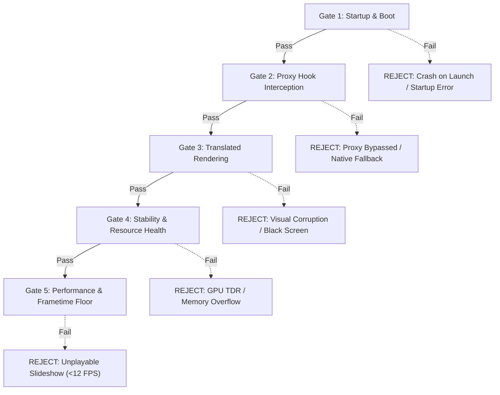

# KeplerBridge Phase 9 — Game Benchmark Plan & Empirical Protocol

**Milestone:** Phase 9 Quality Assurance & Verification  
**Document Version:** 1.0.0  
**Research Date:** October 20, 2026  
**Hardware Reference:** NVIDIA GeForce GT 740 (GK208B, 4052 MB DDR3, 64-bit bus, ~14.4 GB/s bandwidth, Native FL 11_0, Driver 456.71, Windows 10 x64)  
**Objective:** Establish reproducible, empirical benchmark protocols and acceptance criteria for commercial titles tested through KeplerBridge.  

---

## 1. Five-Pillar Acceptance Criteria Framework

To prevent ambiguous claims, every commercial PC title tested through KeplerBridge must satisfy five standardized criteria gates before any compatibility claim is validated.



### Gate 1: Startup & Boot Integrity
* **Requirement:** The executable must launch, initialize all engine subsystems, and reach the interactive title menu without encountering unhandled exceptions (`0xC0000005`), COM initialization crashes (`0x80004005`), or hardware refusal dialogs (e.g. "Feature Level 12_0 required").
* **Verification Method:** Process exit code = 0; clean transition from window creation to interactive menu.

### Gate 2: Proxy Hook Interception
* **Requirement:** The target application must load KeplerBridge’s local `d3d12.dll` and route device creation through `D3D12CreateDevice`. The unwrapped native driver must not be invoked directly.
* **Verification Method:** Inspect `kepler_bridge.log` for:
  ```text
  [PROXY] D3D12CreateDevice called (MinFeatureLevel: 0xc000)
  [PROXY] Successfully instantiated WrappedD3D12Device.
  ```

### Gate 3: Translated Rendering Fidelity
* **Requirement:** Direct3D 12 draw and compute commands must replay accurately onto the Direct3D 11 immediate context. The screen must show correct geometry, textures, lighting, shadows, and UI without critical rendering artifacts (e.g., missing polygons, inverted depth buffers, or blinding full-screen color flashes).
* **Verification Method:** Visual frame capture inspection; depth buffer verification via swapchain backbuffer readback.

### Gate 4: Stability & Resource Bounds
* **Requirement:**
  1. **No Driver TDR:** The translation process must not trigger Windows WDDM Timeout Detection and Recovery (`0x887A0005` `DXGI_ERROR_DEVICE_REMOVED`).
  2. **VRAM Ceiling:** Total committed VRAM must remain strictly under the physical ceiling of **3,800 MB** (leaving 252 MB for the OS and D3D11 runtime).
  3. **Zero Memory Leaking:** Memory allocation must stabilize after initial scene loading (<50 MB growth over 10 minutes of continuous gameplay).
* **Verification Method:** GPU-Z memory logging at 100 ms polling intervals.

### Gate 5: Performance & Frametime Consistency
* **Requirement:** The game must maintain a minimum interactive framerate floor:
  * **Turn-Based / Strategy Titles:** Average framerate >= 20 FPS; 1% low >= 12 FPS.
  * **Action / Real-Time Exploration:** Average framerate >= 16–18 FPS; 1% low >= 10 FPS.
  * **Frametime Consistency:** Standard deviation of frametimes must not exceed 25 ms during steady-state walking.
* **Verification Method:** CapFrameX / MSI Afterburner telemetry logs recording frametime percentiles.

---

## 2. Standardized Test Bench Environment

| Parameter | Test Bench Configuration |
| :--- | :--- |
| **GPU Hardware** | NVIDIA GeForce GT 740 (GK208B, 384 CUDA Cores, 28nm) |
| **VRAM Configuration** | 4052 MB DDR3 (64-bit bus, 900 MHz memory clock, ~14.4 GB/s bandwidth) |
| **Driver Version** | NVIDIA GeForce Game Ready Driver 456.71 (WDDM 2.7) |
| **Host System** | Windows 10 Pro x64 (Version 22H2, OS Build 10.0.19045) |
| **Display Mode** | 1280x720 (720p), Exclusive Fullscreen or Borderless Windowed |
| **Monitoring Tools** | CapFrameX v1.7.2, GPU-Z v2.57.0, KeplerBridge Internal Logger (`LogLevel=3`) |

---

## 3. Dedicated Benchmark Protocols for Key Titles

---

### Protocol A: Elden Ring (FromSoftware)

* **Game Version:** v1.10.1 (Steam Build)  
* **Launch Configuration:** Offline Mode (replace `start_protected_game.exe` with redirected batch or copy `eldenring.exe` to bypass Easy Anti-Cheat).  
* **In-Game Settings:**
  * Resolution: 1280x720
  * Quality Preset: Low
  * Texture Quality: Medium (uses ~2.0 GB VRAM)
  * SSAO: OFF
  * Depth of Field: OFF
  * Motion Blur: OFF
  * Volumetric Effect: Low
* **Benchmark Route:**
  1. Spawn at `The First Step` Site of Grace in Limgrave.
  2. Walk north towards the `Church of Elleh` following the stone path.
  3. Cross the open field past the wandering Tree Sentinel (avoiding aggro).
  4. Enter the Church of Elleh ruins and rest at the Site of Grace.
* **Duration:** 180 seconds.
* **Acceptance Thresholds:**
  * Average Framerate: >= 18.0 FPS
  * 1% Low Framerate: >= 11.0 FPS
  * Max VRAM Allocation: <= 2,600 MB
  * Pass Condition: Gate 1-5 satisfied; zero white-screen startup crashes.

---

### Protocol B: Horizon Zero Dawn (Decima Engine)

* **Game Version:** v1.11.2 (Complete Edition)  
* **In-Game Settings:**
  * Resolution: 1280x720
  * Preset: Favor Performance
  * Adaptive Performance FPS: OFF
  * FSR 1.0: Quality
  * Field of View: 70
* **Preflight Step:** Enable KeplerBridge persistent shader disk cache (`EnableShaderDiskCache=true`) to avoid initial shader optimization freeze.  
* **Benchmark Route:**
  1. Load Mother's Heart village settlement save file.
  2. Walk through the main festive courtyard past NPC clusters.
  3. Exit through the southern gate towards the mountain trail.
  4. Stand on the cliff overlook scanning the horizon.
* **Duration:** 120 seconds.
* **Acceptance Thresholds:**
  * Average Framerate: >= 16.0 FPS
  * 1% Low Framerate: >= 10.0 FPS
  * Disk Cache Hits: >= 95% on secondary run
  * Pass Condition: Successful boot through shader compilation stage without TDR.

---

### Protocol C: Stray (BlueTwelve Studio / UE 4.27)

* **Game Version:** v1.0.4  
* **In-Game Settings:**
  * Resolution: 1280x720
  * Resolution Scale: 80% (effective 1024x576 internal render)
  * Effects Quality: Low
  * Shadow Quality: Low
  * Mesh Quality: Medium
* **Targeted Verification Focus:** Verifies the Phase 9 COM child object fix (`GetDevice()` returns `WrappedD3D12Device`).  
* **Benchmark Route:**
  1. Start Chapter 2 ("Dead City").
  2. Navigate through the alleyway puddles, jumping onto air conditioner units.
  3. Traverse across the rooftops through the broken neon sign.
* **Duration:** 150 seconds.
* **Acceptance Thresholds:**
  * Average Framerate: >= 24.0 FPS
  * 1% Low Framerate: >= 15.0 FPS
  * Pass Condition: Zero crash during level geometry streaming; `GetDevice()` calls successfully intercepted.

---

### Protocol D: Final Fantasy VII Remake Intergrade (Square Enix / UE 4.18)

* **Game Version:** v1.002  
* **In-Game Settings:**
  * Resolution: 1280x720
  * Texture Resolution: Low
  * Shadow Resolution: Low
  * Characters Displayed: 5
* **Targeted Verification Focus:** Verifies initial pipeline state preservation on `CommandList::Reset(alloc, pInitialState)`.  
* **Benchmark Route:**
  1. Load Chapter 3 ("Home Sweet Slum") save.
  2. Walk from Stargazer Heights apartment building through Sector 7 market area.
  3. Approach Seventh Heaven bar.
* **Duration:** 120 seconds.
* **Acceptance Thresholds:**
  * Average Framerate: >= 20.0 FPS
  * 1% Low Framerate: >= 12.0 FPS
  * Pass Condition: No missing character or environmental meshes; initial PSO applied correctly on every frame reset.

---

### Protocol E: Resident Evil 2 / 3 Remake (Capcom / RE Engine)

* **Game Version:** Next-Gen D3D12 Update (DX11 removed)  
* **In-Game Settings:**
  * Resolution: 1280x720
  * Rendering Mode: Normal (Not interlaced)
  * Image Quality: 80%
  * Texture Quality: Medium (0.5 GB)
  * Lighting Quality: Low
  * Ambient Occlusion: OFF
* **Targeted Verification Focus:** Verifies swapchain fallback to `DXGI_SWAP_EFFECT_DISCARD` on D3D11.0 and multi-slot UAV atomic counters.  
* **Benchmark Route:**
  1. Enter R.P.D. Police Station Main Hall.
  2. Walk up the central staircase to the 2F balcony.
  3. Turn on the flashlight and enter the West Hallway corridor.
* **Duration:** 120 seconds.
* **Acceptance Thresholds:**
  * Average Framerate: >= 22.0 FPS
  * 1% Low Framerate: >= 14.0 FPS
  * Pass Condition: Swapchain creation succeeds without `0x887A0001`; volumetric flashlight cone renders without artifacts.

---

### Protocol F: Palworld (Dual-Mode Verification Protocol)

* **Objective:** Empirically demonstrate the architectural boundary between unsupported D3D12 SM 6.0 DXIL and native D3D11 execution.  
* **Mode 1: D3D12 with KeplerBridge (Verification of Rejection)**
  * Launch arguments: None (default D3D12 mode).
  * Expected Outcome: `kepler_bridge.log` logs `KB_ERR_UNSUPPORTED_STAGE` on Niagara compute shader creation; application halts with actionable diagnostic hint advising the player to use `-dx11`.
* **Mode 2: Native Direct3D 11 Execution (Baseline Reference)**
  * Launch arguments: `-dx11` (or `-d3d11`).
  * Expected Outcome: Unreal Engine 5.1 selects native `D3D11RHI`; launches cleanly on physical GT 740 without KeplerBridge proxy; renders character creation and starting island.
  * Baseline Metric: 720p Very Low ~18-24 FPS.
  * Scientific Value: Establishes unambiguous proof that native D3D11 is the optimal path for Palworld on Kepler hardware.

---

## 4. Telemetry Data Logging & Archival Schema

For every official benchmark run, the following telemetry assets must be captured and preserved in `benchmarks/`:

1. **`kepler_bridge.log`:** Full runtime execution trace capturing device capability negotiation, translated PSO counts, and cache hit metrics.
2. **`capframex_telemetry.csv`:** Millisecond-accurate timestamped frametime log.
3. **`gpuz_sensor_log.csv`:** Real-time hardware telemetry:
   * GPU Core Clock (MHz)
   * GPU Temperature (°C)
   * Memory Controller Load (%)
   * Dedicated VRAM Usage (MB)
4. **`screenshot_gate3.png`:** In-game visual proof capturing geometry, lighting, and HUD elements.
