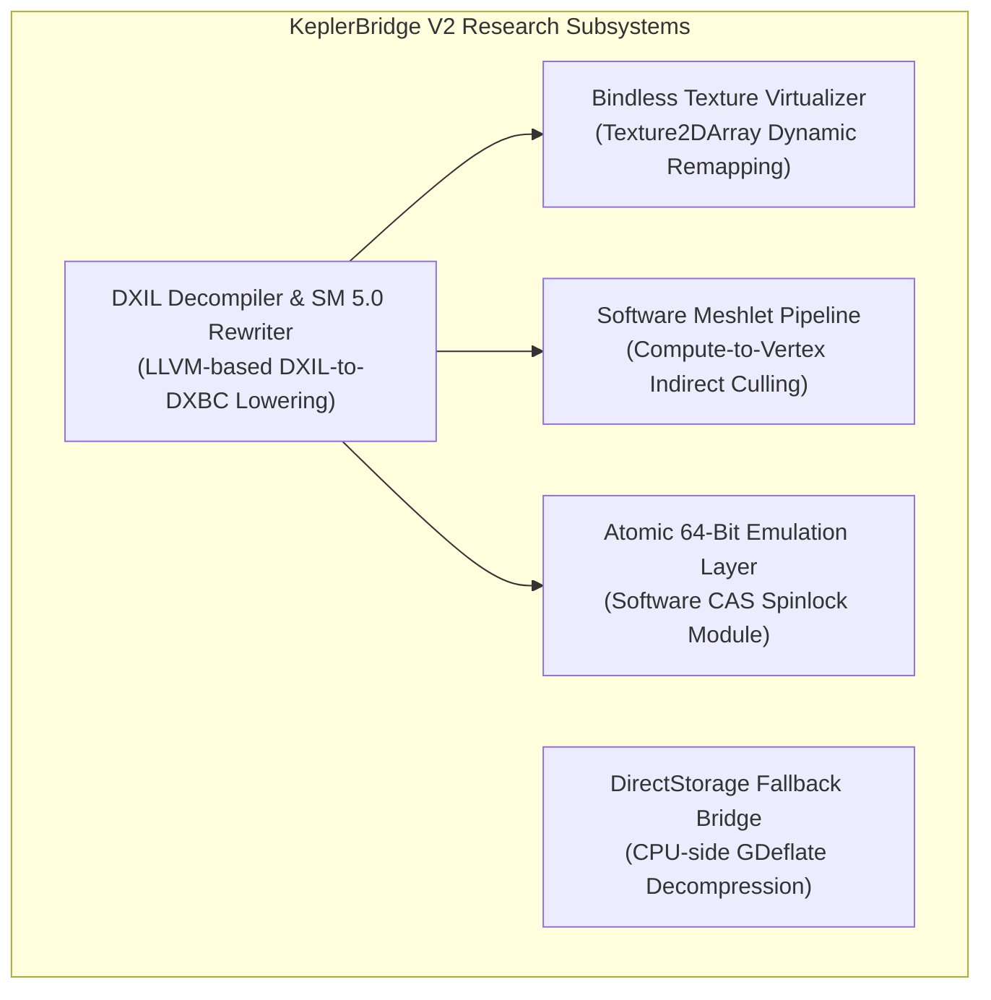

# KeplerBridge Phase 9 — V2 Architecture Roadmap & Long-Term Targets

**Milestone:** V2 Long-Term Architectural Planning  
**Document Version:** 1.0.0  
**Research Date:** October 20, 2026  
**Hardware Reference:** NVIDIA GeForce GT 740 (GK208B, 4052 MB DDR3, Native FL 11_0, Driver 456.71, Windows 10 x64)  
**Objective:** Define architectural requirements, software fallback feasibility, and hardware limits for widely desired games requiring major translation subsystems.  

---

## 1. Architectural Philosophy for V2

While V1 and Phase 9 focus on bounded translation within the existing Direct3D 11.0 Feature Level 11_0 architecture, **KeplerBridge V2** targets the complex Direct3D 12 paradigms that modern game engines increasingly mandate.

### The Realistic Silicon Ceiling (Kepler GK208)
When planning V2 architectural extensions, we must strictly respect physical hardware realities:
1. **Memory Bandwidth:** The 64-bit DDR3 memory bus (~14.4 GB/s) represents an immovable bottleneck. Techniques that achieve high performance on GDDR6 (300–600 GB/s) by writing intermediate buffers to VRAM will suffer severe bandwidth starvation on DDR3.
2. **Fixed-Function Geometry Hardware:** Kepler GK208 possesses fixed-function vertex fetch, primitive assembly, and rasterization units. It possesses zero native hardware for task/mesh shaders or hardware raytracing.
3. **Compute Core Count:** With 384 CUDA cores clocked at ~993 MHz, compute-heavy software emulation (e.g. software BVH traversal or software rasterization) has a tight compute budget.
4. **Transparent Honesty:** V2 development will explore software fallbacks and bytecode lowering, but will **never promise that every advanced title will achieve playable framerates**.

---

## 2. Deep Technical Breakdown of Major V2 Targets

---

### Target 1: Alan Wake 2

* **Developer / Publisher:** Remedy Entertainment / Epic Games Publishing  
* **Release Date:** October 27, 2023  
* **Engine:** Northlight Engine (Next-Gen Revision)  
* **Core Technological Blocker:** **Mesh Shaders (SM 6.5)** and Amplification Shaders via Direct3D 12 Ultimate.  

#### Shader & Pipeline Requirements
* *Task & Mesh Shaders:* Northlight completely bypassed traditional vertex and geometry shaders in *Alan Wake 2*. All world geometry, dense foliage, and character models are dispatched as **meshlets** (clusters of up to 64 vertices and 126 primitives) processed by mesh shader threadgroups.
* *Amplification Shaders:* Perform dynamic frustum and occlusion culling per meshlet before launching mesh shader workgroups.

#### Software Fallback Feasibility on GT 740
* *Is a Software Fallback Technically Possible?*
  **Theoretically Yes.** A software translation path can emulate mesh shaders using a multi-pass compute pipeline:
  1. An emulation compute shader reads the meshlet descriptor buffer and performs amplification/culling.
  2. A secondary compute shader transforms vertices, unpacks meshlet indices, and writes traditional vertex and index buffers into temporary VRAM scratch allocations.
  3. The proxy issues an `ExecuteIndirect` / `DrawIndexedInstanced` command on the generated buffer to standard D3D11 vertex shaders.
* *Is it Computationally Reasonable on GT 740?*
  **No.** In native mesh shading on modern GPUs, meshlets stay on-chip in L1/Shared Memory. Emulating this via D3D11 compute requires round-tripping geometry through VRAM:
  `Meshlet Data in VRAM -> Compute Shader Read -> Culled Geometry written to VRAM -> Vertex Shader Read from VRAM`.
  On a 14.4 GB/s DDR3 bus, writing and re-reading millions of vertices saturates memory throughput instantly, resulting in a **projected framerate of <3 FPS**.
* *Required V2 Subsystem:* `ComputeMeshletVirtualizer` (Research-Only Prototype).
* *Impossible Requirement:* Hardware-accelerated, on-chip meshlet expansion cannot be added to Kepler silicon.

---

### Target 2: Cyberpunk 2077

* **Developer / Publisher:** CD Projekt RED  
* **Release Date:** December 10, 2020 (Updated through Patch 2.1)  
* **Engine:** REDengine 4  
* **Core Technological Blocker:** **Resource Binding Tier 3 (Full Bindless Textures)** and unbounded descriptor arrays.  

#### Shader & Pipeline Requirements
* *Unbounded Descriptor Tables:* Shaders declare unbounded arrays of 2D textures:
  ```hlsl
  Texture2D g_Textures[] : register(t0, space0);
  SamplerState g_Samplers[] : register(s0, space0);
  ```
  Pixel shaders dynamically index textures using non-uniform integer IDs calculated per pixel (`g_Textures[NonUniformResourceIndex(materialID)].Sample(...)`).
* *D3D11 Hardware Limit:* Direct3D 11.0 Feature Level 11_0 permits a maximum of **128 Shader Resource Views (SRVs) per shader stage** (`t0` through `t127`). It cannot natively bind thousands of textures simultaneously.

#### Software Fallback Feasibility on GT 740
* *Is a Software Fallback Technically Possible?*
  **Yes, via Texture Array Packing & Virtual Page Tables.**
  KeplerBridge V2 could intercept texture registrations, cluster textures of matching dimensions/formats into large `Texture2DArray` resources (up to 2,048 slices in D3D11), and rewrite shader bytecode to translate dynamic descriptor indices into `(ArraySRV, SliceIndex)` pairs.
* *Is it Computationally Reasonable on GT 740?*
  **Borderline Feasible at Low Settings.** Texture arrays add minor arithmetic overhead. However, Night City's massive streaming asset footprint will stress the 4 GB VRAM capacity and 14.4 GB/s memory bandwidth, resulting in aggressive texture pop-in.
* *Required V2 Subsystem:* `BindlessTextureArrayPacker` & `HLSLDynamicIndexRewriter`.

---

### Target 3: Starfield

* **Developer / Publisher:** Bethesda Game Studios / Bethesda Softworks  
* **Release Date:** September 6, 2023  
* **Engine:** Creation Engine 2  
* **Core Technological Blocker:** **Wave Intrinsics**, **64-bit Integer Atomics**, and Agility SDK.  

#### Shader & Pipeline Requirements
* *Wave Intrinsics:* Compute culling passes use `WaveActiveAllTrue`, `WaveReadLaneFirst`, and `WavePrefixSum`.
* *64-bit Atomics:* Lighting clustering and visibility buffers rely on `InterlockedCompareExchange64` and 64-bit integer buffer UAVs.
* *Hardware Baseline:* Minimum 6 GB VRAM floor; Bethesda hardcoded strict checks for Feature Level 12_0.

#### Software Fallback Feasibility on GT 740
* *Is a Software Fallback Technically Possible?*
  64-bit atomics can theoretically be emulated in SM 5.0 compute shaders using 32-bit atomic CAS spinlocks on paired words (`low_word`, `high_word`).
* *Is it Computationally Reasonable on GT 740?*
  **No.** GPU spinlocks on SIMD architectures cause extreme warp divergence. If thread 0 in a warp acquires the lock, other threads in the same 32-thread warp must spin; however, on SIMD architectures, divergent threads execute sequentially, creating severe thread stalls and triggering driver TDR timeouts.
* *Required V2 Subsystem:* `Atomic64SoftwareEmulationLayer` & `AgilitySDKBridge`.

---

### Target 4: Metro Exodus Enhanced Edition

* **Developer / Publisher:** 4A Games / Deep Silver  
* **Release Date:** May 6, 2021  
* **Engine:** 4A Engine (Enhanced Raytracing Revision)  
* **Core Technological Blocker:** **Pure Hardware Raytracing (DirectX Raytracing / DXR 1.1)**.  

#### Shader & Pipeline Requirements
* *100% Raytraced Lighting:* 4A Games completely excised the legacy rasterized lighting, shadow-map, and screen-space ambient occlusion pipelines.
* *Ray Generation & Closest-Hit Shaders:* Every light source traces rays through a Top-Level and Bottom-Level Acceleration Structure (TLAS/BLAS) using DXR `TraceRay()` intrinsics.

#### Software Fallback Feasibility on GT 740
* *Is a Software Fallback Technically Possible?*
  **Practically Impossible.** While Microsoft created an experimental software DXR fallback driver in 2018 for early DX12 testing, evaluating bounding volume hierarchies (BVH) in software compute on 384 Kepler CUDA cores without BVH traversal hardware or tensor cores yields **under 1 FPS**.
* *Verdict:* **Permanently Incompatible with Kepler GT 740.** Pure DXR games require dedicated silicon raytracing hardware (RT Cores).

---

### Target 5: Forza Horizon 5

* **Developer / Publisher:** Playground Games / Xbox Game Studios  
* **Release Date:** November 9, 2021  
* **Engine:** ForzaTech  
* **Core Technological Blocker:** Hardcoded startup check for Feature Level 12_0, Resource Binding Tier 2/3, and Tiled Resources Tier 2 (triggers fatal crash `Error FH501`).  

#### Software Fallback Feasibility on GT 740
* *Tiled Resources Emulation:* ForzaTech streams open-world terrain tiles using D3D12 Reserved/Tiled resources. D3D11 Feature Level 11_0 does not support `ID3D11Device2::CheckMultisampleQualityLevels` or tiled resource paging.
* *Required V2 Subsystem:* `TiledResourceSoftwareVirtualizer` with virtual page swapping.

---

### Target 6: Ratchet & Clank: Rift Apart

* **Developer / Publisher:** Insomniac Games / Sony Interactive Entertainment  
* **Release Date:** July 26, 2023  
* **Engine:** Proprietary Insomniac Engine  
* **Core Technological Blocker:** **DirectStorage 1.2 GPU Decompression (GDeflate)**.  

#### Software Fallback Feasibility on GT 740
* *DirectStorage GPU Decompression:* Streams geometric assets and high-resolution textures directly from NVMe storage into VRAM using GPU compute decompression kernels.
* *D3D11 Fallback:* D3D11 lacks DirectStorage decompression queues. Assets must be decompressed on the host CPU and transferred across the PCIe bus, introducing multi-second pauses during dimensional rift portals.
* *Required V2 Subsystem:* `DirectStorageCPUFallbackBridge`.

---

### Target 7: Lords of the Fallen (2023) / Black Myth: Wukong (2024)

* **Developer / Publisher:** Hexworks / CI Games & Game Science  
* **Release Date:** October 2023 / August 2024  
* **Engine:** Unreal Engine 5.2 / Unreal Engine 5.4  
* **Core Technological Blocker:** **Nanite Virtualized Geometry** and **Lumen Global Illumination**.  

#### Technical Reality
* *Nanite Micro-Polygon Rasterization:* Bypasses fixed-function hardware rasterizers, performing sub-pixel software rasterization in compute shaders via 64-bit atomic operations on visibility buffers.
* *Verdict:* **Research-Only.** Emulating Nanite's dense compute passes on Kepler GK208 without native 64-bit atomics and with only 14.4 GB/s DDR3 bandwidth is technically insurmountable for real-time playability.

---

### Target 8: Halo Infinite

* **Developer / Publisher:** 343 Industries / Xbox Game Studios  
* **Release Date:** November 15, 2021  
* **Engine:** Slipspace Engine  
* **Core Technological Blocker:** **Kernel-Level Anti-Cheat (Arbiter)** and mandatory Feature Level 12_0 hardware verification.  

#### Technical Reality
* *Anti-Cheat Enforcement:* Arbiter operates as a kernel-level driver that validates all loaded modules and system DLLs. It actively rejects proxy `d3d12.dll` binaries.
* *Verdict:* **Out of Scope.** In accordance with KeplerBridge security guidelines, the project contains zero anti-cheat circumvention code.

---

## 3. V2 Architectural Subsystem Roadmap



| Subsystem Name | Primary Function | Target Games | Architectural Complexity | Hardware Feasibility on GT 740 |
| :--- | :--- | :--- | :---: | :---: |
| **DXIL Decompiler & Lowering** | Disassembles DXIL bitcode and generates SM 5.0 DXBC | *Palworld (D3D12)*, *Tekken 8*, *Ghostrunner 2* | **Extreme** | High (CPU-bound compilation) |
| **Bindless Texture Virtualizer** | Packs unbounded descriptor arrays into `Texture2DArray` | *Cyberpunk 2077*, *Marvel's Spider-Man* | **High** | Medium (VRAM/Bandwidth bound) |
| **Compute Meshlet Virtualizer** | Translates Task/Mesh shaders into compute culling passes | *Alan Wake 2* | **Extreme** | **Unreasonable (<3 FPS)** |
| **Atomic 64-Bit Emulation** | Emulates 64-bit integer atomics via 32-bit CAS pairs | *Starfield*, *Remnant II* | **High** | Low (Severe warp stall risk) |
| **DirectStorage Fallback** | Decompresses GDeflate assets on CPU worker threads | *Ratchet & Clank*, *Ghost of Tsushima* | **Medium** | Medium (PCIe latency overhead) |
